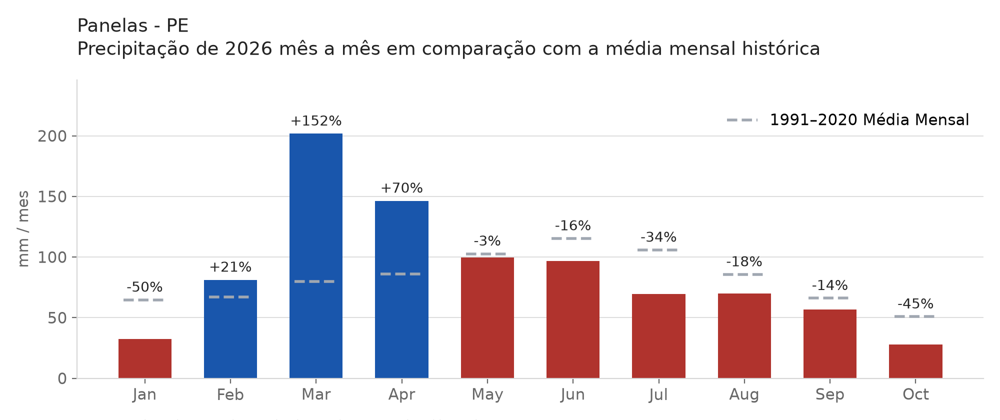
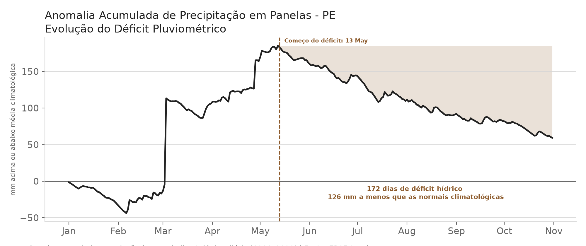
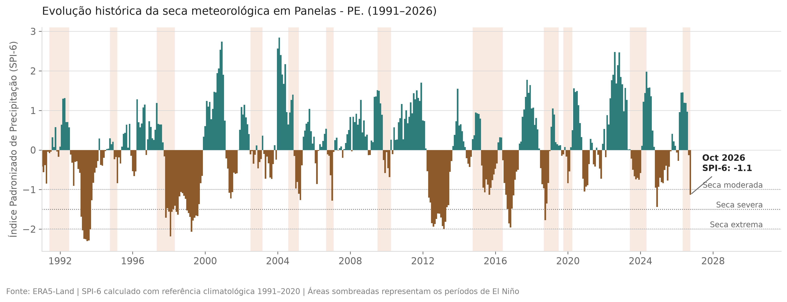

# Hero Section <!--{ as="image" mode="hero" src="assets/exemplo.jpeg" }-->
#### Eventos Extremos no Brasil em 2026 - Parte II <!--{ style="font-size:5rem;opacity:0.9;margin-top:1rem;" }-->

##  <!--{ style="width: 100%; max-width: 720px; display: block; margin: 1rem auto;" }-->

## Impactos do El Nino

Este projeto foi desenvolvido através do Future Tech Leaders Brasil como projeto final e coletivo pelos estudantes. Para dar continuidade a série de impactos causados por eventos extremos no Brasil no ano de 2026, e como esses impactos podem ser associados ao fenômeno do El Niño, esse estudo visa elencar algum dos desastres e buscar correlações históricas e climáticas, dando respaldo da série de eventos acontencendo em território brasileiro com o alarmante estado de aquecimento das águas do pacíco, registrada em temperaturas nunca antes vistas. 

Se você perdeu o primeiro episódio, pode encontrá-lo aqui: [El-Nino-episodio-1](https://luizhenrque.github.io/CAPSTONE-FTL-BRASIL/#section-eventos-extremos-no-brasil-em-2026)

## Aqui vou começar o meu tour de imagens  <!--{ as="img" mode="tour" }-->

### <!--{ src="assets/walker-circulation-1440-nasa.webp" style="background: #fff0c4;" }-->
Fonte: NOAA/Climate.gov

#### Durante o El Nino
O aumento da temperatura da água nos trópicos, principalmente na metade central do oceano pacífico, favorece a circulação de grandes massas de ar na direção do continente americano. Essa redistribuição do calor do oceano provocada pelo anomalia, causa diferentes reações no Brasil. 

#### Circulação Atmosférica do Equacador 
O aumento da umidade do ar, com a maior evaporação da água provocada pela anomalia do aquecimento, provoca os conhecidos *jet streams*, os quais são ventos fortes carregando a umidade do oceano pacífico. Essa disrupção da circulação do ar em tempos de condições neutras causa um aumento significativo de precipitações na parte sul do Brasil e um conhecido regime de seca na região nordeste.

Nas próximas sessões, vamos ver como esses impactos podem estar relacionados. 

## Impactos de Eventos Extremos

## Seca na Região Agreste de Pernambuco <!--{ as="eox-map" class="overlay-br" mode="tour" }-->

###  <!--{ projection="globe" layers='[{"type":"Tile","properties":{"id":"osm"},"source":{"type":"OSM"}}]' center=[-46.13,-8.66] zoom="6" animationOptions="{duration:1000}" }-->
#### Regime de Seca
A região agreste de Pernambuco vem sofrendo com a seca e diversos municípios já decretaram situação de emergência. Segundo a ANA, 25% do território de pernambuco já sofre com as secas 

### <!--{ projection="EPSG:3857" layers='[{"type":"Tile","properties":{"id":"osm"},"source":{"type":"OSM"}},{"type":"Vector","properties":{"id":"seca-nordeste"},"source":{"type":"Vector","url":"assets/seca/nordeste_seca_out26.geojson","format":"GeoJSON"},"style":{"fill-color":["match",["get","severidade"],"S0","rgba(255,255,0,0.7)","S1","rgba(252,211,127,0.7)","S2","rgba(255,170,0,0.7)","S3","rgba(230,0,0,0.7)","rgba(0,0,0,0)"],"stroke-color":"rgba(80,80,80,0.6)","stroke-width":0.5}}]' center=[-64,-9.7] zoom="5" animationOptions="{duration:1500}" }-->
#### Severidade da seca no Nordeste – Outubro de 2026

S0 – Seca fraca (amarelo) · S1 – Seca moderada (laranja claro) · S2 – Seca grave (laranja) · S3 – Seca extrema (vermelho)

*Dados: Monitor de Secas (ANA), outubro de 2026, recortado para a região Nordeste (IBGE/geobr).* <!--{ style="opacity: 0.7; font-size: 0.85rem;" }-->

### <!--{ projection="EPSG:3857" layers='[{"type":"Tile","properties":{"id":"osm"},"source":{"type":"OSM"}},{"type":"Tile","properties":{"id":"customId"},"source":{"type":"WMTSCapabilities","url":"https://tiles.maps.eox.at/wmts/1.0.0/WMTSCapabilities.xml","layer":"s2cloudless-2025"}}]' center=[-36.01,-8.66] zoom="11" animationOptions="{duration:2000}" }-->
#### Panelas – Agreste de Pernambuco
Vamos olhar de perto o município de Panelas, no Agreste pernambucano, e entender como a chuva se comportou em 2026.

## Entendendo a seca em Panelas - PE

### Entendendo o regime de seca
 <!--{ style="width: 100%; max-width: 720px; display: block; margin: 1rem auto;" }-->
Quando calculamos as precipitações baseada nas séries climatológicas, descobrimos que o ano de 2026 começou com precipitações acima das médias para o mês de Fevereiro, Março e Abril. Contudo, como as estações chuvosas nessa parte do território costumam ir de março até setembro, desde Maio está sendo registrado um déficit hídrico na região. 

### Acumulando a precipitação
 <!--{ style="width: 100%; max-width: 720px; display: block; margin: 1rem auto;" }-->
Ao olharmos o desvio acumulado de precipitação conseguimos visualizar de forma mais clara que o ínicio do ano começou com volumes de chuva acima da média climatológica, mas a partir do dia 13 de maio, é possível entender que o déficit hídrico se inicia. Calculamos que há 126 mm de chuva a menos comparado com as normais climatólogicas e a região de Panelas já se encontra há 172 dias em situação de déficit hídrico.

### Índice SPI
 <!--{ style="width: 100%; max-width: 720px; display: block; margin: 1rem auto;" }-->
O Índice Padronizado de Precipitação (SPI – Standardized Precipitation Index) permite avaliar, de forma estatística, o quanto a precipitação acumulada se desvia das condições climatológicas habituais. Valores negativos indicam precipitação abaixo da média histórica, enquanto valores positivos representam condições mais húmidas que o normal. No gráfico, o SPI-6 representa o comportamento da precipitação acumulada ao longo de seis meses, permitindo identificar episódios de seca meteorológica e avaliar a sua intensidade e persistência.

As áreas sombreadas em alaranjado correspondem aos períodos de ocorrência do fenómeno El Niño. A sua representação permite observar a possível relação temporal entre esse fenómeno climático e os episódios de seca registados em Panelas (PE). Nota-se que alguns períodos de El Niño coincidem com episódios de SPI negativo, sugerindo uma possível influência na redução das chuvas na região. Contudo, essa coincidência temporal não estabelece, por si só, uma relação direta de causalidade, uma vez que o regime pluviométrico do Nordeste brasileiro também é condicionado por outros factores oceânicos e atmosféricos.

## Queimadas e Seca na Região Amazônica
Não apenas o Nordeste vem sofrendo com forte regime de secas. O mesmo período sazonal na região amazônica onde o volume de precipitações diminui, impacta com o aumento do número de queimadas. É imporante frisar que o aumento do número de queimadas não pode ser totalmente correlacionado com apenas o El Nino pois há um fator importante de ação humana que contribui para o aumento das queimadas, somado a conflitos sociais, disputas por terra, entre outros conflitos relacionados a uso e ocupação da terra.

## Queimadas <!--{ as="img" mode="tour" style="object-fit: contain; background: #ffffff;" }-->
### <!--{ src="assets/Faz-Amazonia-Manaus.webp" }-->

#### Fumaça e Qualidade do Ar em Manaus
Dentre outras cidades, Manaus tem passado por vários dias com baixa qualidade do ar devido a fumaça causada por queimadas na região. Apontasse que o volume de queimadas aumentou em relação ao ano passado, segundo o monitor de queimadas do INPE. Contudo, especialistas apontam que grande parte dessas queimadas são iniciadas por atividade humana. Apesar da seca na região.  

#### Manaus e Pará durante a fumaça provinda das queimadas. 
A cidade de Manaus sob densas fumaças ocasionadas pelo regime das queimadas no entorno da cidade. A fumaça contém partículas que podem ocasionar problemas de saúde na vida dos habitantes. É crucial entendermos como o período de secas, que pode ser agravado pelo El Nino, contribui para o aumento significativo das queimadas, além da ação humana. 
Fonte da imagem: Fas Amazônia. 

## Entendendo o foco das Queimadas
Através do monitoramento realizado pelo INPE Queimadas, conseguimos definir os focos das queimadas para a região amazônica e para o Pará.

## Focos de queimadas em 2026 no Amazonas e no Pará <!--{ as="eox-map" style="width: 100vw; height: 600px; margin-left: calc(50% - 50vw);" config='{ "layers": [ { "type": "Tile", "properties": { "id": "osm" }, "source": { "type": "OSM" } }, { "type": "Tile", "properties": { "id": "focos-2026", "title": "Focos de queimadas 2026 (INPE)" }, "source": { "type": "TileWMS", "url": "https://terrabrasilis.dpi.inpe.br/queimadas/geoserver/ows", "params": { "LAYERS": "dados_abertos:focos_ano_atual_br_satref", "TIME": "2026-08-01/2026-11-05", "CQL_FILTER": "id_1 IN (13,15)", "FORMAT": "image/png", "TRANSPARENT": true, "VERSION": "1.3.0" } } } ], "view": { "center": [-6901808, -445640], "zoom": 4 } }' }-->

### Sobre os dados
Os pontos que você vê na tela são focos de calor detectados por satélites nos estados do Amazonas e do Pará entre 1º de agosto e 5 de novembro de 2026, segundo o Programa Queimadas do INPE.

## Impacto da fumaça na qualidade do ar
Através de dados do AIRS L3 conseguimos registrar as concentrações de monóxido de carbono que são derivadas dos processos de queimadas. Grandes focos de monóxido de carbono se assemelham a região que estão sofrendo com maiores queimadas. A imagem de satélite a seguir representa o dia 25 de Outubro sobre a área da região amazônica. 

## Monóxido de carbono sobre a Amazônia <!--{ as="eox-map" style="width: 100vw; height: 600px; margin-left: calc(50% - 50vw);" config='{ "layers": [ { "type": "Tile", "properties": { "id": "osm" }, "source": { "type": "OSM" } }, { "type": "Tile", "properties": { "id": "co-2026-10-25", "title": "CO 25/10/2026" }, "source": { "type": "XYZ", "url": "https://gibs.earthdata.nasa.gov/wmts/epsg3857/best/AIRS_L3_Carbon_Monoxide_500hPa_Volume_Mixing_Ratio_Daily_Day/default/2026-10-25/GoogleMapsCompatible_Level6/{z}/{y}/{x}.png", "maxZoom": 6 }, "opacity": 0.75 }, { "type": "Tile", "properties": { "id": "co-2026-10-05", "title": "CO 05/10/2026", "visible": false }, "source": { "type": "XYZ", "url": "https://gibs.earthdata.nasa.gov/wmts/epsg3857/best/AIRS_L3_Carbon_Monoxide_500hPa_Volume_Mixing_Ratio_Daily_Day/default/2026-10-05/GoogleMapsCompatible_Level6/{z}/{y}/{x}.png", "maxZoom": 6 }, "opacity": 0.75 } ], "view": { "center": [-6901808, -445640], "zoom": 4 } }' }-->

### Leitura do mapa
25 de outubro de 2026, o sensor AIRS, a bordo do satélite Aqua, registrou concentrações de monóxido de carbono altas sobre grande parte da Amazônia, incluindo a região de Manaus.

*Fonte: NASA GIBS.*

## Agradecimentos

Através do Future Tech Leaders, esse projeto em grupo é constituído por:
- Andreza de Souza Dias
- Laíne Reis de Moura
- Laissa
- Melissa Francesca de Souza Raymundo
- Renato Ferraz de Mendonça Coelho
- Rodrigo Ramos Rebouças
- Samuel Castro de Castro

 <!--{ style="width: 100%; max-width: 720px; display: block; margin: 1rem auto;" }-->